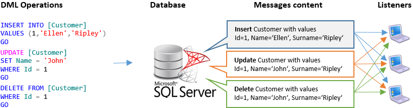
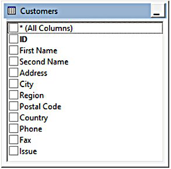
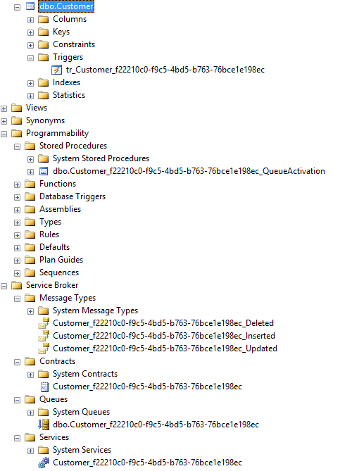

# Monitor and receive notifications on record table change
   [](https://www.nuget.org/packages/Rix.SqlTableDependency/) [](https://scanaislop.com/Rix-Group/monitor-table-change-with-sqltabledependency)

**SqlTableDependency** is a high-level C# component used to audit, monitor and receive notifications on SQL Server's record table changes. 

For any record table change, as insert, update or delete operation, a notification **containing values for the record changed** is delivered to SqlTableDependency. This notification contains insert, update or delete record values.



This **table record tracking change** system has the advantage to avoid a select to retrieve updated table record, because the updated table values record is delivered by notification.

This is a fork of [IsNemoEqualTrue/monitor-table-change-with-sqltabledependency](https://github.com/IsNemoEqualTrue/monitor-table-change-with-sqltabledependency), introducing .NET 10+ support, async methods, builder pattern, and persistent objects.

The package is available via NuGet https://www.nuget.org/packages/Rix.SqlTableDependency.

## Get record table change
If we want **get alert on record table change** without paying attention to the underlying SQL Server infrastructure then SqlTableDependency's record table change notifications will do that for us. Using notifications, an application can **detect table record change** saving us from having to continuously re-query the database to get new values. For any record table change, SqlTableDependency's event handler gets a notification containing modified table record values as well as the INSERT, UPDATE, DELETE operation type executed on database table.

As example, let's assume we are interested to receive record table changes for the following database table:



Start by installing SqlTableDependency.

We now define a C# model mapping table columns we are interested. These properties will be populated with the values resulting from any INSERT, DELETE or UPDATE record table change operation. We do not need to specify all table columns but just the ones we are interested in.

```C#
public class Customer
{
 public int Id { get; set; }
 public string Name { get; set; }
 public string Surname { get; set; }
}
```

Now create a SqlTableDependency instance passing the connection string and  create an event handler for SqlTableDependency's OnChanged event.

```C#
public static class Program
{
    private static string _connectionString = "data source=.; initial catalog=MyDB; integrated security=True";
   
    public static void Main()
    {
        await using var dep = await SqlTableDependency<Customer>.CreateSqlTableDependencyAsync(_connectionString));
        dep.OnChanged += OnChanged;
        await dep.StartAsync();

        Console.WriteLine("Press a key to exit");
        Console.ReadKey();
    }

    public static void OnChanged(RecordChangedEventArgs<Customer> e)
    {
        var changedEntity = e.Entity;

        Console.WriteLine("DML operation: " + e.ChangeType);
        Console.WriteLine("ID: " + changedEntity.Id);
        Console.WriteLine("Name: " + changedEntity.Name);
        Console.WriteLine("Surname: " + changedEntity.Surname);
    }
}
```

Done! Now you are ready to receive record table change notifications.

### Monitor record table change examples and use cases

#### Code First Data Annotations to map model with database table
```C#
[Table("Items", Schema = "Transaction")]
public class Item
{
    public Guid TransactionItemId { get; set; }

    [Column("Description")]
    public string Desc { get; set; }
}
```

#### Explicit database table name
```C#
await using var dep = await SqlTableDependency<Customer>.CreateSqlTableDependencyAsync(
    connectionString,
    schemaName: "dbo",
    tableName: "Customers");
```

#### Custom map between model property and table column using ModelToTableMapper<T>
```C#
var mapper = new ModelToTableMapper<Customer>()
    .AddMapping(c => c.Name, "First Name")
    .AddMapping(c => c.Surname, "Last Name");

await using var dep = await SqlTableDependency<Customer>.CreateSqlTableDependencyAsync(
    connectionString,
    mapper: mapper);
```

#### Specify for which properties we want receive notification using UpdateOfModel<T> mapper
```C#
var updateOfModel = new UpdateOfModel<Customer>();
updateOfModel.Add(i => i.Name);

await using var dep = await SqlTableDependency<Customer>.CreateSqlTableDependencyAsync(
    connectionString,
    updateOf: updateOfModel);
```

#### Filter notification by change type
```C#
await using var dep = await SqlTableDependency<Customer>.CreateSqlTableDependencyAsync(
    connectionString,
    notifyOn: NotifyOn.Insert);
```

#### Handle events
```C#
await using var dep = await SqlTableDependency<Customer>.CreateSqlTableDependencyAsync(
    connectionString);

dep.OnChanged += OnChanged;
dep.OnException += OnException;
dep.OnStatusChanged += OnStatusChanged;

public void OnChanged(RecordChangedEventArgs<Customer> e)
    => _ = e.Entity;

private void OnException(ExceptionEventArgs e)
    => _ = e.Exception;

private void OnStatusChanged(StatusChangedEventArgs e)
    => _ = e.Status
```

#### Handle async events
```C#
await using var dep = await SqlTableDependency<Customer>.CreateSqlTableDependencyAsync(
    connectionString);

dep.OnChangedAsync = OnChangedAsync;
dep.OnExceptionAsync = OnExceptionAsync;
dep.OnStatusChangedAsync = OnStatusChangedAsync;

public async Task OnChangedAsync(RecordChangedEventArgs<Customer> e)
    => _ = e.Entity;

private async Task OnExceptionAsync(ExceptionEventArgs e)
    => _ = e.Exception;

private async Task OnStatusChangedAsync(StatusChangedEventArgs e)
    => _ = e.Status
```

#### Logging with ILogger
```C#
await using var dep = await SqlTableDependency<Customer>.CreateSqlTableDependencyAsync(
    connectionString,
    logger: logger);
```

#### Include old values
```C#
await using var dep = await SqlTableDependency<Customer>.CreateSqlTableDependencyAsync(
    connectionString,
    includeOldValues: true);

dep.OnChanged += OnChanged;

public void OnChanged(RecordChangedEventArgs<Customer> e)
{
    var changedEntity = e.Entity;
    Console.WriteLine("DML operation: " + e.ChangeType);
    Console.WriteLine("ID: " + changedEntity.Id);
    Console.WriteLine("Name: " + changedEntity.Name);
    Console.WriteLine("Surname: " + changedEntity.Surname);

    var oldEntity = e.EntityOldValues;
    Console.WriteLine("Old ID: " + oldEntity.Id);
    Console.WriteLine("Old Name: " + oldEntity.Name);
    Console.WriteLine("Old Surname: " + oldEntity.Surname);
}
```

#### Apply filter with LINQ expression
```C#
ITableDependencyFilter filter = new SqlTableDependencyFilter<Customer>(p => p.Name == "Josh");
await using var dep = await SqlTableDependency<Customer>.CreateSqlTableDependencyAsync(
    connectionString,
    filter: filter);
```

#### Apply filter with custom SQL
```C#
public class CustomSqlTableDependencyFilter(string name) : ITableDependencyFilter
{
    public string Translate()
        => $"[Name] = {name}"
}

#### Persist SQL objects and pickup missed events
```C#
await using var dep = await SqlTableDependency<Customer>.CreateSqlTableDependencyAsync(
    connectionString,
    persistentId: "persistent");
```

#### Get all columns of a table with ExpandoObject
```C#
await using var dep = await SqlTableDependency<ExpandoObject>.CreateSqlTableDependencyAsync(
    connectionString);
```

#### Wait until cancellation or error
```C#
await using var dep = await SqlTableDependency<Customer>.CreateSqlTableDependencyAsync(
    connectionString);
dep.OnChanged += _ => { };
await dep.StartAsync(waitForStop: true, ct: ct);
``` 

#### Monitoring and self-healing
A listener can outlive the objects it depends on: a snapshot revert or restore, or someone dropping or disabling the trigger, a queue, a service or the activation procedure.
Two mechanisms recover without restarting the process:

- **Reconnect.** If the listener's receive fails (killed session, failover, a broker object missing under it), it reports `TableDependencyStatus.Reconnecting`, backs off 1s doubling to 60s, repairs objects and resumes. After `ReconnectTimeout` (default 30 minutes; `TimeSpan.Zero` restores the old immediate stop; `Timeout.InfiniteTimeSpan` never gives up) it stops with `OnException` + `StopDueToError` as before. A fault thrown by your own handler is never retried.
- **Heartbeat check.** The library does not poll. Call `CheckDatabaseObjectsAsync` from your heartbeat. It reports missing or disabled objects and, while `AutoRepair` is `true` (the default) and the listener is running, rebuilds them. It never repairs after `StopAsync`.

```C#
var health = await dependency.CheckDatabaseObjectsAsync(ct);
if (!health.IsHealthy)
    logger.LogError("Listener unhealthy: {Issues} (still broken: {Remaining}) {Error}", health.Issues, health.Remaining, health.RepairError);
```

Object repair needs no rights beyond those `StartAsync` already checks. If Service Broker is disabled (typical after a restore or snapshot revert), repair re-enables it, but only when the principal holds `ALTER` on the database. It uses `ENABLE_BROKER WITH NO_WAIT`, so it never kills other sessions: if anyone else is connected it fails, reports `RepairError`, and the next attempt tries again. If the database is a restored copy whose broker ID is already in use (error 9772), it falls back to `NEW_BROKER`, which ends every conversation in that database. Without `ALTER`, the broker shows up in `Remaining` with a `ServiceBrokerNotEnabledException` until someone enables it. The objects are rebuilt either way.

#### Create a builder that can be used with dependency injection
```C#
internal class MyBuilder
    : SqlTableDependencyBuilder<Customer>
{
    public MyBuilder(IOptions<ConnectionStrings> connectionStrings)
        : base(connectionStrings.Value.Vensis)
    {
        PersistentId = nameof(MyBuilder);
        // You can set every configure async option here
    }
}

services.AddTransient<ITableDependencyBuilder<Customer>, MyBuilder>();
services.AddTransient<MyService>();

internal class MyService(ILogger<MyService> logger, ITableDependencyBuilder<Customer> builder)
{
    private readonly ILogger<MyService> _logger = logger;
    private readonly ITableDependencyBuilder<Customer> _builder = builder;

    public async Task DoWork(CancellationToken ct)
    {
        await using var dep = await _builder.BuildAsync(_logger, ct);
        dep.OnChanged += _ => { };
        await dep.StartAsync(ct: ct);
    }
}
```

## How track record table change is done
SqlTableDependency's record change audit, provides the low-level implementation to receive database record table change notifications by creating SQL Server triggers, queues, and service broker that immediately notifies your application when a record table change happens.

Assuming we want to monitor the Customer table content, we create a SqlTableDependency object specifying the Customer table and the following database objects will be generated:
* Message types
* Contract
* Queue
* Service Broker
* Trigger on table to be monitored
* Stored procedure to clean up the created objects in case the application exits abruptly (that is, when the application terminate without disposing the SqlTableDependency object and persistent id is not set).



### Watchdog timeout
The `StartAsync(int timeout = 120, int watchdogTimeout = 180)` method starts the listener to receive record table change notifications.
The `watchdogTimeout` parameter specifies the amount of time in seconds for the watch dog system.

After calling the `StopAsync()` method, record table change notifications are no longer delivered. Database objects created by SqlTableDependency will be deleted (Trigger, Service Broker, Queue, Contract, Messages type and Stored Procedure) if persistent id is not set.

It is a good practice to use SqlTableDependency with an `await using` statement to run `StopAsync()` automatically within `DisposeAsync()`.

When the application exits abruptly, the `StopAsync()` and/or `DisposeAsync()` method will not run. We need a way to cleaning up the SqlTableDependency infrastructure. The `StartAsync()` method takes an optional parameter `watchdogTimeout` which defaults to 180 seconds. If there are no listeners waiting for notifications in this time, the SqlTableDependency infrastructure will be removed.

Debugging can trigger the watchdog. During development, you often spend several minutes inside the debugger before you move on to the next step. Please make sure to increase `watchdogTimeout` when you debug an application, otherwise you will experience an unexpected destruction of database objects in the middle of your debugging activity.

## Limitations
This project targets .NET 10 or later versions.

When the database connection has been lost, if persistent id is not set, there is no way to re-connect SqlTableDependency instance to its queue and notifications will be missed.

Windows service using SqlTableDependency **must not goes to SLEEP mode or IDLE state**. Sleep mode blocks SqlTableDependency code and this result in running the database watch dog that drops all SqlTableDependency's db objects (please see https://stackoverflow.com/questions/6302185/how-to-prevent-windows-from-entering-idle-state).

### Service broker
To use notifications, you must be sure to enable Service Broker for the database. To do this run the SQL command:
```SQL
ALTER DATABASE MyDatabase SET ENABLE_BROKER
```
### Permissions

A database **Administrator**, **db owner**, or member of the **db_owner** role needs no further grants. Otherwise the permission guard checks the **effective** rights via `HAS_PERMS_BY_NAME`, so a right counts whether it comes from a direct grant, a role, or schema ownership.

The Service Broker objects (two queues and the activation procedure) need object-level `REFERENCES`/`ALTER`/`RECEIVE` (e.g. `CREATE SERVICE ... ON QUEUE` needs `REFERENCES` on the queue). The owner of a schema holds those rights on every object in it without any `CONTROL` grant, so the library puts the broker objects in a dedicated `SqlTableDependency` schema (only the trigger stays on the monitored table's schema). No application code change is needed.

For least privilege, pre-create that schema owned by the application principal and grant the narrow set below:

```SQL
CREATE SCHEMA [SqlTableDependency] AUTHORIZATION [app_user];
GRANT CONNECT, CREATE QUEUE, CREATE SERVICE, CREATE CONTRACT, CREATE MESSAGE TYPE, CREATE PROCEDURE TO [app_user];
GRANT ALTER, SELECT ON OBJECT::[dbo].[Customer] TO [app_user];   -- per monitored table
```

| Securable | Permission |
|---|---|
| Database | `CONNECT`, `CREATE QUEUE`, `CREATE SERVICE`, `CREATE CONTRACT`, `CREATE MESSAGE TYPE`, `CREATE PROCEDURE` |
| `[SqlTableDependency]` schema | ownership via `CREATE SCHEMA ... AUTHORIZATION [app_user]` |
| Monitored table | `ALTER` and `SELECT` on `OBJECT::[schema].[table]` (`ALTER` lets the library create the trigger and carries metadata visibility) |

If the schema does not exist the library creates it on startup, which requires `CREATE SCHEMA` (held by `db_owner`/`CONTROL`, and also by a database-scope `GRANT ALTER`); pre-creating it avoids granting any of those. Note this is about *creating* a schema — database-scope `GRANT ALTER`/`GRANT SELECT` are still not equivalent to the object-level grants above: db-scope `ALTER` does not confer `ALTER` on an existing schema or table (only ownership / `CONTROL` / object-level `ALTER` does), which is what the effective-permission guard checks.

Earlier versions also asked for `EXECUTE`, `VIEW DEFINITION`, `VIEW DATABASE STATE` and `SUBSCRIBE QUERY NOTIFICATIONS`. They are no longer required: `SUBSCRIBE QUERY NOTIFICATIONS` belongs to the unrelated `SqlDependency` query-notification feature, and `EXECUTE`/`VIEW DEFINITION` on the activation procedure are implied by ownership of the `SqlTableDependency` schema (the procedure is run by Service Broker itself under its `EXECUTE AS` context, not invoked by the application).

In case you specify SqlTableDependency's QueueExecuteAs property (default value is "SELF"), it can also be necessary set TRUSTWORTHY database property using:
```SQL
ALTER DATABASE MyDatabase SET TRUSTWORTHY ON
```

### String comparison
SqlTableDependency does not consider an empty string different from a string containing only spaces; example: '' and '   ' are considered equals. This means that in there is case of an update from '' to '  ' and vice versa, it will not be notified. Same is true for NULL and empty string.

### In-memory OTLP tables
SqlTableDependency works with traditional disk-based tables, it does not works with In-Memory OLTP tables.

### Compatibility level and database version
Please, check how David Green solved this problem: https://github.com/christiandelbianco/monitor-table-change-with-sqltabledependency/wiki/Contributors

Even if your SQL Server instance is SQL Server 2008 R2 or a later versions, you may face a bug if your Database has been created using an old SQL Server version, for example SQL Server 2005.

To reproduce this issue, you can download Northwind.mdf file and then attach it to your SQL Server 2008 R2 (or greater) instance. Running SqlTableDependency against it, no exception is raised as well as no notification on record table change is detected.

In order to discover your database compatibility version, you can use the following [SQL script](http://jongurgul.com/blog/database-created-version-internal-database-version-dbi_createversion/). 

```SQL
USE <your db>

DECLARE @DBINFO TABLE ([ParentObject] VARCHAR(60),[Object] VARCHAR(60),[Field] VARCHAR(30),[VALUE] VARCHAR(4000))
INSERT INTO @DBINFO
EXECUTE sp_executesql N'DBCC DBINFO WITH TABLERESULTS'
SELECT [Field]
,[VALUE]
,CASE
WHEN [VALUE] = 515 THEN 'SQL 7'
WHEN [VALUE] = 539 THEN 'SQL 2000'
WHEN [VALUE] IN (611,612) THEN 'SQL 2005'
WHEN [VALUE] = 655 THEN 'SQL 2008'
WHEN [VALUE] = 661 THEN 'SQL 2008R2'
WHEN [VALUE] = 706 THEN 'SQL 2012'
WHEN [VALUE] = 782 THEN 'SQL 2014'
WHEN [VALUE] = 852 THEN 'SQL 2016'
WHEN [VALUE] > 852 THEN '> SQL 2016'
ELSE '?'
END [SQLVersion]
FROM @DBINFO
WHERE [Field] IN ('dbi_createversion','dbi_version')
```
Executing this script on a DB created by SQL Server 2008 R2 instance (database name TableDependencyDB), the result is:


So, even if your SQL Server instance is 2008 R2 or greater, DB compatibility level (VALUE column) is fundamental to receive record table change notifications.

## SqlTableDependency vs SqlDependency (ADO.NET)
Functionalities comparison between Microsoft ADO.NET SqlDependency and SqlTableDependency:

Functionality | SqlTableDependecy | SqlDependency
------------- | ----------------- | -------------
View |  | 
Join multiple tables |  | 
Where |  | 
Generic |  | 
Notification containing updated values |  | 
Notification containing old values |  | 
Notification only on insert |  | 
Notification only on update |  | 
Notification only on delete |  | 
Notification only when specific column is changes |  | 

## Useful link and tips
* https://sqlrus.com/2014/10/compatibility-level-vs-database-version/
* https://stackoverflow.com/questions/41169144/sqltabledependency-onchange-event-not-fired
* https://stackoverflow.com/questions/11383145/sql-server-2008-service-broker-tutorial-cannot-receive-the-message-exception
* Deleting multiple records then inserting using **sql bulk copy**, only deleted change events are raised: to solve this problem, set **SqlBulkCopyOptions.FireTriggers**. Thanks to Ashraf Ghorabi!

## Contributors
Open-source software (OSS) is a type of computer software in which source code is released under a license in which the copyright holder grants users the rights to study, change, and distribute the software to anyone and for any purpose. Open-source software may be developed in a collaborative public manner. Please, feel free to help and contribute with this project adding your comments, issues, or bugs found as well as proposing fix and enhancements. [See contributors in the original repo](https://github.com/christiandelbianco/monitor-table-change-with-sqltabledependency/wiki/Contributors).